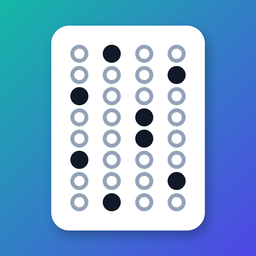
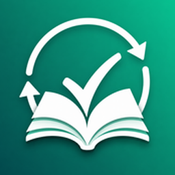

&nbsp;&nbsp;&nbsp;

<h1 align="center">Revisal & Gradal</h1>

<b>One free, open-source iPhone project for the classroom, in two apps: Gradal for the teacher, Revisal for the student. Both run on the same built-in hybrid AI through Firebase AI Logic. No key to paste.</b>

<a href="https://github.com/ibnkabed/revisal-gradal-firebase/releases/latest/download/Gradal-unsigned.ipa">⬇️ Gradal (teacher)</a> · <a href="https://github.com/ibnkabed/revisal-gradal-firebase/releases/latest/download/Revisal-unsigned.ipa">⬇️ Revisal (student)</a> · <a href="https://github.com/ibnkabed/revisal-gradal-firebase/releases">Releases</a> · <a href="دليل-الاستخدام.md">دليل الاستخدام (Arabic guide)</a>

**[Watch it on YouTube](https://youtu.be/nQApLRJ69KU)**: both real apps in the iOS simulator, with live Firebase AI Logic calls. Devpost project: https://devpost.com/software/revisal-gradal

Each user installs the app for their role: a teacher takes Gradal, a student takes Revisal. They are two apps because each is a full app on its own, and one app holding both would be heavy for everyone. Both work alone on the phone, with no computer, no account and no server, and show their interface in Arabic or English, following the phone's language.

## Gradal, for the teacher

Add a textbook as a PDF, in any subject, in Arabic or English, and Gradal writes the quiz. It prepares the question paper, the answer key and an answer sheet with each student's name; you print them from the phone, grade the sheets with its camera in seconds, and share the gradebook as an Excel file.

- **Writes questions from your book:** pick the pages, name the paper's parts, and set each part's type and number of questions. You review and edit every question before approving it.
- **Arabic and English papers:** an Arabic paper runs right to left, with the ministry header and the options أ ب ج د; an English paper runs left to right, with A B C D. Each quiz's papers keep its own language.
- **Students imported automatically:** from the Excel or PDF file exported from Noor (the Saudi school system). Gradal finds the classes and numbers every student. You can also paste names or add a student by hand.
- **Prints from the phone:** on any AirPrint printer.
- **Grades with the camera:** Gradal reads the quiz and the student from the sheet itself, and scanning works offline. Each student gets a marked copy: green on the right answer, red on a wrong choice, with each question's score and the total.
- **Results:** every student's score, class statistics, an analysis of every question, and an Excel gradebook with a sheet per class.

## Revisal, for the student

Revisal helps students review what they studied: their school subjects, and Saudi Arabia's national exams, Qudrat and Tahsili. Every question has four options and is solved on the phone, with no printing.

- **Your own curriculum:** add any textbook or summary as a PDF, name its units by their pages, then pick a unit and 1 to 10 questions. AI writes the questions across the unit's sections and skills, and **Refresh** brings new ones.
- **Qudrat and Tahsili banks:** bundled and offline: 2,004 Tahsili questions (math, physics, chemistry, biology) and 4,007 Qudrat questions (verbal and quantitative). No question repeats until the whole bank is done.
- **Explain:** under every question, the AI explains why the correct answer is right, only when the student asks, and the explanation is saved on the phone.
- **Results:** the score, the score per skill, every answer next to the correct one, and **Retry my mistakes**.

**About Qudrat and Tahsili.** These are Saudi Arabia's two national standardized tests, run by the National Center for Assessment (Qiyas). Qudrat (General Aptitude) measures verbal and quantitative reasoning; Tahsili (Scholastic Achievement) measures what the student learned in math, physics, chemistry and biology. Most Saudi universities rank applicants by a composite of the high-school GPA and these two scores, so they decide admission, and good practice material is mostly paid.

## One hybrid AI engine for both, with Firebase AI Logic

Both apps share one engine, `FirebaseHybrid.swift` ([in Gradal](gradal/ios/Gradal/AI/FirebaseHybrid.swift), [in Revisal](revisal/ios/Revisal/AI/FirebaseHybrid.swift), identical):

| Request | Where it runs | Why |
|---|---|---|
| A short request in a language Apple's on-device model supports, such as a few pages of an English text or an Explain under an English question | **On the iPhone**, with Apple's Foundation Models | Private, free, works offline |
| A long chapter, Arabic content, or a phone without Apple Intelligence | **Gemini in the cloud** through Firebase AI Logic | Large context, and Arabic, which the on-device model doesn't support yet |
| Scanned book pages, figures and PDF student lists | **Gemini in the cloud** (multimodal) | The on-device model takes text only |
| The on-device model fails, or a cloud model is busy or out of free quota | **Falls back** to the cloud, then to a second Gemini model | The user always gets an answer |

- **On the device:** `LanguageModelSession(model: SystemLanguageModel.default, …)`, after checking `isAvailable`, `supportsLocale(_:)` and that the prompt fits the 4,096-token context.
- **In the cloud on iOS 27:** `LanguageModelSession(model: ai.geminiLanguageModel(name:), …)`, the same Foundation Models API with Gemini behind it.
- **In the cloud on every iOS version:** `FirebaseAI.firebaseAI(backend: .googleAI()).generativeModel(…)` for JSON replies and files (`InlineDataPart`).
- **Who calls it:** each app's `AIClient` tries the built-in AI first ([Gradal](gradal/ios/Gradal/AI/AIClient.swift), [Revisal](revisal/ios/Revisal/AI/AIClient.swift)); Gradal's `ExamMaker` writes quizzes, and Revisal writes review questions and explanations. In Revisal a small label above each explanation names the engine that answered.
- **Supporting Firebase products:** **App Check** is enforced for AI Logic, and **Remote Config** holds `cloud_model`, `cloud_fallback_model` and `on_device`, so no model name is fixed in the apps.
- **Optional keys:** the user's own free keys (Gemini, Qwen, Groq, Cerebras, Mistral, OpenRouter, DeepSeek) are still in **Settings**, as a fallback. In Gradal, a linked key also checks the written questions against the book.

## Built during #BuildHybridAI (November 2026)

Gradal (v2.7) and Revisal (v1.0) existed before the hackathon, with AI only through keys the user pasted. During the hackathon both gained:

1. **The built-in hybrid AI:** on-device Apple Foundation Models with a Gemini cloud fallback, through Firebase AI Logic.
2. **App Check and Remote Config.** The Firebase config is injected at build time from repository secrets.
3. **Full English interfaces,** with the layout following the phone's language (`en.lproj/Localizable.strings` and `Model/Localize.swift` in each app), and English explanations for English questions in Revisal, so they can run on the device.
4. **A Built-in AI section in Settings,** which shows whether the on-device model is available.
5. **Demo-recording workflows** that run the real apps in the iOS simulator with live Firebase calls, and this single repository holding both apps.

## Install

1. Download the app for your role from the [latest release](https://github.com/ibnkabed/revisal-gradal-firebase/releases/latest): `Gradal-unsigned.ipa` for the teacher, `Revisal-unsigned.ipa` for the student.
2. Install it with [Sideloadly](https://sideloadly.io/) and a free Apple ID.
3. Open **Settings → Built-in AI**: it shows "Ready with no key" and whether Apple's on-device model is available.

**Requirements:** iOS 17 or later. The on-device path needs iOS 26 or later on an iPhone with Apple Intelligence turned on; every other phone uses the cloud path.

The full step-by-step guide, in Arabic, is [دليل-الاستخدام.md](دليل-الاستخدام.md).

## Repository layout

| Path | What it holds |
|---|---|
| [`gradal/`](gradal/) | Gradal: the iPhone app (`ios/`), the sheet layouts (`shared/`), the Python reference reader (`reference/`) and test tools (`tools/`) |
| [`revisal/`](revisal/) | Revisal: the iPhone app (`ios/`) and the bundled question banks (`bank/`) |
| [`docs/`](docs/) | The data and design notes of both apps |
| [`.github/workflows/`](.github/workflows/) | Building, testing, screenshots and demo recording for both apps |

## Build

There is no Mac in this project: everything builds on GitHub Actions. [`build.yml`](.github/workflows/build.yml) checks both apps (Gradal's camera reader on synthetic sheets, Revisal's review rules and bundled banks) and builds them as unsigned IPAs on the `xcode-27` runner. To build with the built-in AI, add these repository secrets:

- `GRADAL_GOOGLE_SERVICE_INFO_PLIST_B64` and `REVISAL_GOOGLE_SERVICE_INFO_PLIST_B64`: each app's `GoogleService-Info.plist` in base64. They are never committed.
- `APP_CHECK_DEBUG_TOKEN`: an App Check debug token registered for both apps in your Firebase project.

Without them both apps still build, and simply hide the built-in AI.

## Contributing

See [CONTRIBUTING.md](CONTRIBUTING.md) and the [Code of Conduct](CODE_OF_CONDUCT.md).

## License

MIT. You may use, copy, change and share both apps for free, as long as the copyright line stays in every copy. See [LICENSE](LICENSE).

Copyright (c) 2026 IbnKabed
